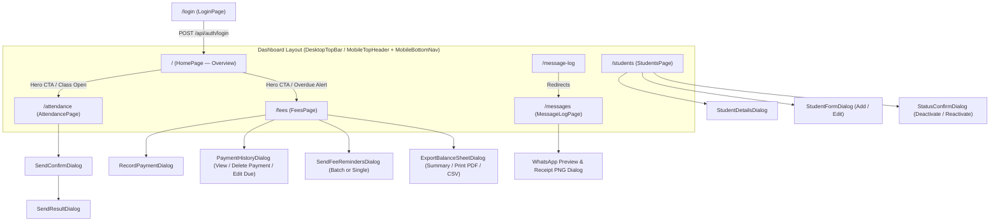

# QA, Functional & UI/UX Audit Report (`QA_UX_AUDIT_REPORT.md`)

**Target Application:** Akshara Academy Management Portal (Web App + Capacitor Android App + Supabase Backend)  
**Tech Stack:** Next.js 16.4.5 (App Router, React 19, TypeScript), Tailwind CSS v4 + shadcn/ui, Supabase (`@supabase/ssr`, `@supabase/supabase-js`, PostgreSQL + RLS + Edge Functions + `pg_cron`), Satori/Resvg (`next/og`) PNG Receipt Generator, Capacitor Android v8.6.0, Meta WhatsApp Cloud API  
**Main User Role:** Academy Manager (2 authorized manager accounts; no student/parent login)  
**Core User Flows:** Manager Login/Logout, Student Registry (CRUD + Deactivate/Reactivate), Daily Class Attendance & Absentee WhatsApp Alerts, Monthly Fee Generation, Full/Partial Fee Payment Recording & Image Receipt WhatsApp Delivery, Scheduled & Manual Fee Reminders, Fee Balance Sheet & Excel/PDF Export, WhatsApp Message Log & Failed Message Retry  
**Target Devices & Users:** Non-technical academy managers operating primarily on mid-range Android phones (via Capacitor WebView or mobile Chrome) and desktop browsers in India (`Asia/Kolkata` / IST timezone)  
**Audit Date:** 2026-11-12  
**Audit Mode:** Strictly Read-Only Functional, Edge-Case, UI/UX & Code-Level Audit

---

## 1. Executive Summary

### Overall Quality Assessment
Akshara Academy is a focused, well-structured internal management app with strong visual hierarchy, clean mobile-first cards, thoughtful Indian localization (`₹` formatting, `+91` phone parsing, IST helpers on backend routes), and helpful guardrails (overpayment confirmation, duplicate student warning, unsaved attendance warning).

However, end-to-end tracing of the financial, WhatsApp receipt, and timezone workflows revealed **several critical and high-severity functional bugs** where data shown or sent in one module diverges from what was recorded in another.

### Count of Findings by Severity

| Severity | Functional / Logic | UI / UX | Performance / Code | Total |
| :--- | :---: | :---: | :---: | :---: |
| **Critical** | 2 | 0 | 0 | **2** |
| **High** | 4 | 0 | 0 | **4** |
| **Medium** | 3 | 2 | 0 | **5** |
| **Low** | 0 | 2 | 1 | **3** |
| **Polish** | 0 | 1 | 0 | **1** |
| **Total** | **9** | **5** | **1** | **15** |

### Top 10 Issues in Plain Language
1. **Partial Payment Receipts Show Full Monthly Fee (`amount_due`) Instead of Actual Amount Paid in Message Log & Retry (`CRITICAL` — QA-001):** Because `message_log` does not store `payment_id` or the paid installment amount, previewing or downloading a payment receipt in the **Messages** tab—or retrying a failed receipt—uses `fees.amount_due` (or cumulative `amount_paid`) instead of that specific payment's amount, and hardcodes the payment mode as `PAID` and class as `Student`.
2. **Database Deduplication Index Blocks Same-Day Split Payments and Fallback Receipts (`CRITICAL` — QA-002):** The unique index `message_log_dedupe` on `(student_id, kind, related_date)` allows only one non-failed log per student per kind per day. If a parent makes two partial payments on the same day (e.g., part Cash, part UPI), or if a receipt falls back to `kind = 'fee_reminder'` on the same day a morning reminder was sent, the `message_log` insert silently fails with a unique constraint conflict.
3. **Client-Side `toISOString()` Shifts Fee Due Dates Back by 1 Day and Uses UTC Instead of IST (`HIGH` — QA-003):** In `FeesPage` fallback fee generation (`new Date(y, m - 1, dueDay).toISOString().split('T')[0]`), midnight in IST (`UTC+05:30`) converts to `18:30 UTC` on the **previous calendar day**, setting every student's due date to the 4th instead of the 5th. Additionally, `AttendancePage`, `FeesPage`, and `RecordPaymentDialog` compute "today" using UTC instead of IST, causing a 5.5-hour window (12:00 AM – 5:30 AM IST) where "today" is yesterday.
4. **Manual "Send WhatsApp Reminder" on a Fee Row Ignores the Clicked Fee Period and Fails After 2 Reminders (`HIGH` — QA-004):** Clicking **Send WhatsApp reminder** on a specific fee row only passes `student_id` (not `fee_id`) to `/api/send-fee-reminders`, which picks the student's oldest unpaid month instead of the clicked month, and blocks manual sending if 2 reminders were already sent.
5. **`fee_due_day` and `notes` Exist in Database & Details View, But Cannot Be Entered or Edited in `StudentFormDialog` (`HIGH` — QA-005):** The Student Details modal shows **Fee Due Day: Day 5 of every month** and **Notes**, and monthly fee generation uses `fee_due_day`, but `StudentFormDialog` has no input fields for either column.
6. **Deleting a Payment Leaves Stale Totals in `PaymentHistoryDialog` & Red "Failed Message" Dot Never Clears (`HIGH` — QA-006):** After deleting a payment inside `PaymentHistoryDialog`, the dialog header still displays the old `amount_paid` and `balance` because `selectedFee` in `FeesPage` is a static object snapshot. Similarly, the red notification dot on the **Messages** nav tab never clears after retrying failed messages (`setHasFailedMessages(false)` is never called).
7. **Message Log Hard-Caps at 150 Rows Without Server-Side Filtering or Pagination (`MEDIUM` — QA-007):** `MessageLogPage` queries `.limit(150)` and filters in browser memory, so the header badge never exceeds `150 Total` and searching/filtering for older failed messages returns empty results.
8. **Home "Overdue Fees Alert" and Cumulative Balance Sheet Count Fee Rows as "Students" (`MEDIUM` — QA-008):** If 1 student is overdue for 3 months, the Home alert badge says **3 students** are overdue, and the "All Months" Class-Wise Balance Sheet multiplies the student count by the number of billed months.
9. **New Student Added After Morning Attendance Appears "Present" Without a Database Row (`MEDIUM` — QA-009):** If a class's attendance is taken at 9:00 AM and a new student is added at 10:00 AM, opening `/attendance` shows the class as `Taken (09:00 am)` and renders the new student as `Present` (default UI state), even though no row exists for them in `attendance`.
10. **Copy-Pasted Fetch Logic in `FeesPage` Causes Reminder Count Drift on Initial Load vs. Refresh (`LOW` — QA-012):** `FeesPage` duplicates its 90-line data loader in `fetchFeesData` and `useEffect`. One excludes `payment_receipt_v1` from reminder counts while the other does not, causing `Reminders: X/2` to change when clicking Refresh.

### Biggest UX Friction Points
- **Home → Fees "View Overdue Fees" Dead-End (`QA-014`):** Tapping **View Overdue Fees** on the Home alert banner opens `/fees` filtered to the current month with `Status: All` instead of activating the `Overdue` filter across all months.
- **Sticky Bottom Attendance Bar Overlap on Mobile (`QA-013`):** On mobile screens, the sticky "Save and notify absentees" bar sits at `bottom-16` (`64px`), slightly overlapping the ~76px `MobileBottomNav` and covering the last student row when scrolled to the bottom.
- **Mixed Visual Palette in Fee Modals (`QA-011`):** While the main screens use the warm purple (`#5B45E0`) and emerald/amber semantic tokens, `RecordPaymentDialog`, `PaymentHistoryDialog`, and `SendFeeRemindersDialog` use hardcoded `blue-600` buttons and `slate-*` borders.

---

## 2. Phase 1: Application Map & Requirements Gap Analysis

### 2.1 Screen & Navigation Map



### 2.2 Features & Role Matrix

| Module | Route / Component | Role | Capabilities |
| :--- | :--- | :--- | :--- |
| **Authentication** | `/login`, `AccountMenu` | Academy Manager | Email/password sign-in (with 5-attempt lockout), session inspection, global sign-out |
| **Home Overview** | `/` | Academy Manager | Hero KPIs (Enrolled, Present, Absent), Overdue Fees alert banner, Today's per-class attendance status list |
| **Students Registry** | `/students` | Academy Manager | Search/filter students, view student details card, add/edit student, deactivate/reactivate student |
| **Daily Attendance** | `/attendance` | Academy Manager | Select class & date (up to today), toggle Present/Absent, Mark all present, Save only, Save & notify absentees via WhatsApp |
| **Fees Management** | `/fees` | Academy Manager | Month switcher & All-Months toggle, generate monthly fees, record full/partial/overpayment + WhatsApp image receipt, view/delete payment history, edit unpaid fee amount, send WhatsApp fee reminders, view/print/export Fee Balance Sheet |
| **Message Audit Log** | `/messages` | Academy Manager | Filter by message type & delivery status, preview WhatsApp chat bubble & receipt PNG, download receipt PNG, retry single or bulk failed messages |

### 2.3 Client API & Database Call Inventory

| Caller | Endpoint / Table | Method / Op | Request Shape | Response Shape |
| :--- | :--- | :--- | :--- | :--- |
| `LoginPage` | `/api/auth/login` | `POST` | `{ email, password }` | `{ success, user, error?, locked?, remaining_attempts? }` |
| `AccountMenu` / `LogoutButton` | `/api/auth/logout` | `POST` | `{}` | `{ success: true }` |
| `AttendancePage` | `functions/v1/send-absent-alerts` (fallback `/api/send-absent-alerts`) | `POST` | `{ class_level, date }` | `{ dry_run, sent, failed, already_sent, skipped_no_consent, total_absentees }` |
| `RecordPaymentDialog` | `/api/send-payment-receipt` | `POST` | `{ student_id, fee_id, payment_id, amount_paid, paid_on, period, mode, reference }` | `{ dry_run, sent, receipt_no, skipped_no_consent?, error? }` |
| `SendFeeRemindersDialog` | `/api/send-fee-reminders` | `POST` | `{ dry_preview?: boolean, student_id?: string }` | `{ dry_run, sent, failed, already_sent, skipped_no_consent, preview_recipients? }` |
| `ExportBalanceSheetDialog` | `/api/export-fees` | `GET` | `?month=YYYY-MM\|all&class_level=...&status=...&format=json\|csv` | JSON report object or `text/csv` attachment |
| `MessageLogPage` | `/api/receipt-image` | `GET` | `?student=...&class=...&amount=...&period=...&date=...&receipt=...&mode=...` | `image/png` (800×480 receipt card) |
| `MessageLogPage` | `/api/retry-message` | `POST` | `{ message_log_id?: string, message_log_ids?: string[] }` | `{ dry_run, retried_count, success_count, failed_count, details }` |

### 2.4 Forms & Validation Inventory

| Form | Component | Fields | Client Validation | Server / DB Validation |
| :--- | :--- | :--- | :--- | :--- |
| **Sign In** | [src/app/login/page.tsx](file:///c:/Users/new/akshara%20app/src/app/login/page.tsx) | `email`, `password` | `required`, `type="email"`, disabled when empty or locked | Regex email validation, length 6–256, rate limiter, allowlist check |
| **Add / Edit Student** | [src/components/students/student-form-dialog.tsx](file:///c:/Users/new/akshara%20app/src/components/students/student-form-dialog.tsx) | `full_name`*, `class_level`*, `school`, `admission_no`, `admission_date`, `status`, `address`, `parent_name`*, `phone`*, `whatsapp_opt_in`, `monthly_fee`* | Required checks on `fullName`, `parentName`, `phone`; `parseAndFormatIndianPhone` (`+91[6-9]\d{9}`); duplicate `full_name + class_level` check | DB `NOT NULL`, `UNIQUE (admission_no)`, `CHECK (phone ~ '^\+91[6-9][0-9]{9}$')`, `CHECK (status IN ('active','inactive'))` |
| **Record Payment** | [src/components/fees/record-payment-dialog.tsx](file:///c:/Users/new/akshara%20app/src/components/fees/record-payment-dialog.tsx) | `amount`*, `paid_on`*, `mode`*, `reference`, `sendReceipt`, `confirmOverpayment` | `amount > 0`, `paidOn <= todayStr`, overpayment checkbox required if `amount > fee.balance` | DB `CHECK (amount > 0)` |
| **Edit Fee Amount Due** | [src/components/fees/payment-history-dialog.tsx](file:///c:/Users/new/akshara%20app/src/components/fees/payment-history-dialog.tsx) | `newAmountDue`* | `payments.length === 0 && fee.amount_paid === 0`, `newAmountDue > 0`, `window.confirm` | DB trigger `trg_enforce_fee_amount_due_lock` prevents edit if payments exist |

### 2.5 Requirements / Schema Completeness Gaps
Comparing the database schema ([schema.sql](file:///c:/Users/new/akshara%20app/schema.sql), [migration_student_registry.sql](file:///c:/Users/new/akshara%20app/migration_student_registry.sql)) and UI components:
1. **Missing Form Inputs for `fee_due_day` and `notes` (`Partial`):** Present in `students` table, TypeScript types (`Student`), and `StudentDetailsDialog`, but omitted from `StudentFormDialog`.
2. **Legacy Schema File Split (`Partial`):** `schema.sql` still defines the initial `batches` and `guardians` tables while `migration_student_registry.sql` drops them and adds `class_level`, `parent_name`, `phone`, `whatsapp_opt_in` to `students`. Additionally, `migration_student_registry.sql` does not include a migration statement to widen `message_log_kind_check` to include `'payment_receipt'` on databases created before `payment_receipt` was added to `schema.sql`.
3. **Missing `payment_id` Foreign Key on `message_log` (`Missing`):** `message_log` links to `student_id` and `fee_id`, but not `fee_payments(id)`, making it impossible for `MessageLogPage` or `/api/retry-message` to know the exact installment amount, payment mode, or receipt reference of a partial payment.

---

## 3. Findings Summary Table

| ID | Severity | Type | Title | Location | Status |
| :--- | :---: | :---: | :--- | :--- | :---: |
| **QA-001** | **Critical** | Functional / Financial | Message Log Receipt Preview, Download PNG, and Retry Use `fees.amount_due` Instead of Actual Paid Installment Amount | [src/app/(dashboard)/messages/page.tsx:61-95](file:///c:/Users/new/akshara%20app/src/app/(dashboard)/messages/page.tsx#L61-L95), [src/app/api/retry-message/route.ts:188-216](file:///c:/Users/new/akshara%20app/src/app/api/retry-message/route.ts#L188-L216) | Confirmed |
| **QA-002** | **Critical** | Functional / DB | Unique Index `message_log_dedupe` Blocks Multiple Same-Day Partial Payment Receipts and Collides on `fee_reminder` Fallback | [migration_student_registry.sql:10-12](file:///c:/Users/new/akshara%20app/migration_student_registry.sql#L10-L12), [src/app/api/send-payment-receipt/route.ts:148-180](file:///c:/Users/new/akshara%20app/src/app/api/send-payment-receipt/route.ts#L148-L180) | Confirmed |
| **QA-003** | **High** | Functional / Date-Time | Client-Side `.toISOString()` Shifts Generated Fee Due Dates Back by 1 Day in IST and Uses UTC for "Today" | [src/app/(dashboard)/fees/page.tsx:150,432](file:///c:/Users/new/akshara%20app/src/app/(dashboard)/fees/page.tsx#L432), [src/app/(dashboard)/attendance/page.tsx:40](file:///c:/Users/new/akshara%20app/src/app/(dashboard)/attendance/page.tsx#L40) | Confirmed |
| **QA-004** | **High** | Functional | Manual "Send WhatsApp Reminder" from Fee Row Menu Ignores Selected `fee_id` and Is Blocked After 2 Reminders | [src/app/(dashboard)/fees/page.tsx:556-559](file:///c:/Users/new/akshara%20app/src/app/(dashboard)/fees/page.tsx#L556-L559), [src/app/api/send-fee-reminders/route.ts:125,254-257](file:///c:/Users/new/akshara%20app/src/app/api/send-fee-reminders/route.ts#L254-L257) | Confirmed |
| **QA-005** | **High** | Functional / CRUD | `fee_due_day` and `notes` Are Displayed in Student Details and Used in Fee Generation, But Cannot Be Edited in `StudentFormDialog` | [src/components/students/student-form-dialog.tsx:162-174](file:///c:/Users/new/akshara%20app/src/components/students/student-form-dialog.tsx#L162-L174), [src/components/students/student-details-dialog.tsx:184-201](file:///c:/Users/new/akshara%20app/src/components/students/student-details-dialog.tsx#L184-L201) | Confirmed |
| **QA-006** | **High** | Functional / State | Stale `selectedFee` Snapshot in `PaymentHistoryDialog` After Deleting a Payment & Sticky Red Dot in `dashboard-nav.tsx` | [src/components/fees/payment-history-dialog.tsx:134-161,251-273](file:///c:/Users/new/akshara%20app/src/components/fees/payment-history-dialog.tsx#L134-L161), [src/components/dashboard-nav.tsx:66-82](file:///c:/Users/new/akshara%20app/src/components/dashboard-nav.tsx#L66-L82) | Confirmed |
| **QA-007** | **Medium** | Functional / Data | Message Log Hard-Caps Query at 150 Rows (`limit(150)`) Without Pagination or Server-Side Filtering | [src/app/(dashboard)/messages/page.tsx:148,201,382](file:///c:/Users/new/akshara%20app/src/app/(dashboard)/messages/page.tsx#L148) | Confirmed |
| **QA-008** | **Medium** | Functional / Math | Home Overdue Banner and Cumulative Balance Sheet Count Fee Rows as Unique "Students" | [src/app/(dashboard)/page.tsx:178-186,354](file:///c:/Users/new/akshara%20app/src/app/(dashboard)/page.tsx#L178-L186), [src/app/api/export-fees/route.ts:288-295](file:///c:/Users/new/akshara%20app/src/app/api/export-fees/route.ts#L288-L295) | Confirmed |
| **QA-009** | **Medium** | Functional | Adding a New Student After Class Attendance Was Taken Shows Them as "Present" Without Saving a Record | [src/app/(dashboard)/attendance/page.tsx:168-198](file:///c:/Users/new/akshara%20app/src/app/(dashboard)/attendance/page.tsx#L168-L198) | Confirmed |
| **QA-010** | **Medium** | UX / Validation | Numeric Inputs Force `0` on Backspace, `admission_no` Conflict Shows Raw DB Error, and Negative `monthly_fee` Has No DB Check | [src/components/students/student-form-dialog.tsx:172,468-477](file:///c:/Users/new/akshara%20app/src/components/students/student-form-dialog.tsx#L468-L477) | Confirmed |
| **QA-011** | **Medium** | UI Consistency | `RecordPaymentDialog`, `PaymentHistoryDialog`, and `SendFeeRemindersDialog` Use Hardcoded `blue-600` / `slate-*` Instead of Theme Tokens | [src/components/fees/record-payment-dialog.tsx:162,230,325](file:///c:/Users/new/akshara%20app/src/components/fees/record-payment-dialog.tsx#L325), [src/components/fees/payment-history-dialog.tsx:276-295](file:///c:/Users/new/akshara%20app/src/components/fees/payment-history-dialog.tsx#L276-L295) | Confirmed |
| **QA-012** | **Low** | Code / Bug | Duplicated Fetch Logic in `FeesPage` Causes `Reminders: X/2` Count Drift Between Initial Load and Refresh | [src/app/(dashboard)/fees/page.tsx:253-260,344-350](file:///c:/Users/new/akshara%20app/src/app/(dashboard)/fees/page.tsx#L253-L260) | Confirmed |
| **QA-013** | **Low** | UI / Mobile Layout | Sticky Attendance Action Bar (`bottom-16`) Partially Overlaps `MobileBottomNav` and Obscures Last Student Row (`pb-24`) | [src/app/(dashboard)/attendance/page.tsx:472,733](file:///c:/Users/new/akshara%20app/src/app/(dashboard)/attendance/page.tsx#L733), [src/components/dashboard-nav.tsx:170](file:///c:/Users/new/akshara%20app/src/components/dashboard-nav.tsx#L170) | Confirmed |
| **QA-014** | **Low** | UX / Navigation | Clicking "View Overdue Fees" on Home Page Opens `/fees` Without Activating the Overdue Filter or All-Months Scope | [src/app/(dashboard)/page.tsx:367-375](file:///c:/Users/new/akshara%20app/src/app/(dashboard)/page.tsx#L367-L375), [src/app/(dashboard)/fees/page.tsx:160-164](file:///c:/Users/new/akshara%20app/src/app/(dashboard)/fees/page.tsx#L160-L164) | Confirmed |
| **QA-015** | **Polish** | Accessibility | Custom Dropdown Menus Lack `Escape` Key Close & `aria-expanded`, and `globals.css` Hides `next-route-announcer` | [src/app/(dashboard)/fees/page.tsx:61-71](file:///c:/Users/new/akshara%20app/src/app/(dashboard)/fees/page.tsx#L61-L71), [src/app/globals.css:151](file:///c:/Users/new/akshara%20app/src/app/globals.css#L151) | Confirmed |

---

## 4. Detailed Findings (Phases 2–8)

---

### [QA-001] Message Log Receipt Preview, Download PNG, and Retry Use `fees.amount_due` Instead of Actual Paid Installment Amount

- **Severity:** **Critical** — High likelihood whenever a parent pays in installments or a receipt fails and is retried; directly corrupts financial receipt amounts shown to parents and managers.
- **Type:** Functional / Financial / WhatsApp Integration
- **Location:** [src/app/(dashboard)/messages/page.tsx](file:///c:/Users/new/akshara%20app/src/app/(dashboard)/messages/page.tsx#L61-L95), [src/app/api/retry-message/route.ts](file:///c:/Users/new/akshara%20app/src/app/api/retry-message/route.ts#L188-L216)

#### Description
When a payment is recorded in `RecordPaymentDialog`, `/api/send-payment-receipt` receives the exact `amount_paid`, `payment_id`, `mode`, and `reference` in the POST request body and generates the initial receipt with those exact values. However, `message_log` only stores `student_id` and `fee_id`—it does not store `payment_id` or the payment's `amount`/`mode`/`reference`.
Consequently:
1. In `MessageLogPage` ([src/app/(dashboard)/messages/page.tsx](file:///c:/Users/new/akshara%20app/src/app/(dashboard)/messages/page.tsx#L61-L95)), `getReceiptImageUrl(log)` and `renderWhatsAppTemplateText(log)` read `log.fees?.amount_due` (the total monthly fee billed, e.g., ₹2,000) instead of the amount actually paid (e.g., ₹500 partial payment), hardcode `mode: 'PAID'`, and construct a fake receipt number `REC-${log.id.slice(0, 6).toUpperCase()}` from the `message_log.id` instead of the `payment_id`!
2. In `/api/retry-message` ([src/app/api/retry-message/route.ts](file:///c:/Users/new/akshara%20app/src/app/api/retry-message/route.ts#L188-L216)), retrying a failed payment receipt queries `fee_summary.amount_paid` (or falls back to `fee.amount_due`), hardcodes `classLevel: 'Student'` (line 210), hardcodes `paymentMode: 'PAID'` (line 215), and uses `REC-${log.id.slice(0, 6)}` instead of the payment's actual receipt number.

#### Evidence
```ts
// src/app/(dashboard)/messages/page.tsx (lines 61-79)
function getReceiptImageUrl(log: MessageLogRow): string {
  const studentName = log.students?.full_name || 'Student'
  const classLevel = log.students?.class_level || 'Student'
  const amountVal = log.fees?.amount_due ? String(Math.round(Number(log.fees.amount_due))) : '0'
  const periodStr = formatPeriod(log.fees?.period || log.related_date)
  const dateStr = formatDate(log.related_date || log.created_at?.split('T')[0])
  const shortId = log.id ? `REC-${log.id.slice(0, 6).toUpperCase()}` : 'REC-PAID'

  const params = new URLSearchParams({
    student: studentName,
    class: classLevel,
    amount: amountVal,
    period: periodStr,
    date: dateStr,
    receipt: shortId,
    mode: 'PAID',
  })
  return `/api/receipt-image?${params.toString()}`
}
```
```ts
// src/app/api/retry-message/route.ts (lines 208-216)
const imgRes = generateReceiptPngResponse({
  studentName: student.full_name,
  classLevel: 'Student',
  amountPaid: String(amountPaid),
  period: periodText,
  paidDate: paidDateText,
  receiptNo: receiptCode,
  paymentMode: 'PAID',
})
```

#### Steps to Reproduce
1. Go to **Fees** (`/fees`) and select a student whose monthly fee (`amount_due`) is **₹2,000**.
2. Click **Record payment**, enter a partial payment of **₹500** via **UPI** with reference `UPI-998877`, and click **Record Payment**.
3. Navigate to **Messages** (`/messages`) and click **Preview** on the Payment Receipt row just created.
4. **Expected:** The receipt image and WhatsApp message text show **₹500**, payment mode **UPI**, and receipt `UPI-998877` (or `REC-<payment_id>`).
5. **Actual:** The receipt image and WhatsApp preview bubble show **₹2,000** (the full `amount_due`), mode **PAID**, and a different receipt number `REC-<message_log_id>`.

#### Impact
Managers downloading a receipt PNG from the Message Log or retrying a failed receipt send parents a receipt for the wrong monetary amount and wrong receipt number.

#### Recommended Fix
Add an optional `payment_id uuid references fee_payments(id) on delete set null` column to `message_log` (or join `fee_payments` in `MessageLogPage` and `/api/retry-message`), pass `payment_id` when inserting into `message_log` in `/api/send-payment-receipt`, and read `payment.amount`, `payment.mode`, `payment.reference`, and `student.class_level` in both `MessageLogPage` and `/api/retry-message`.

---

### [QA-002] Unique Index `message_log_dedupe` Blocks Multiple Same-Day Partial Payment Receipts and Collides on `fee_reminder` Fallback

- **Severity:** **Critical** — Silent audit log loss or blocked second receipt when a parent makes split payments or pays on the same day a fee reminder was sent.
- **Type:** Functional / Database Integrity
- **Location:** [migration_student_registry.sql](file:///c:/Users/new/akshara%20app/migration_student_registry.sql#L10-L12), [src/app/api/send-payment-receipt/route.ts](file:///c:/Users/new/akshara%20app/src/app/api/send-payment-receipt/route.ts#L148-L180)

#### Description
In [migration_student_registry.sql](file:///c:/Users/new/akshara%20app/migration_student_registry.sql#L10-L12), the unique index is defined as:
```sql
create unique index message_log_dedupe
  on message_log (student_id, kind, related_date)
  where status <> 'failed';
```
This creates two severe collisions in `/api/send-payment-receipt`:
1. **Same-Day Split Payments:** If a parent pays ₹500 in Cash and ₹500 via UPI on the same day (`paidDateStr`), the second payment receipt has the exact same `(student_id, 'payment_receipt', paidDateStr)`. The `INSERT` into `message_log` fails with PostgreSQL error `23505` (`unique_violation`). Because `/api/send-payment-receipt` does not check `primaryLogErr` when `fallbackRow` also fails (lines 161–180), `logId` remains `null`, and the second receipt is never recorded in `message_log`!
2. **Same-Day Reminder + Payment Fallback Collision:** If the live database was created before `'payment_receipt'` was added to `message_log_kind_check`, `/api/send-payment-receipt` falls back to inserting `kind: 'fee_reminder'` with `related_date: paidDateStr` (lines 164–175). If the student already received a scheduled `fee_reminder` earlier that morning (`related_date = today`), the fallback insert collides with the morning reminder on `(student_id, 'fee_reminder', today)` and fails!

#### Evidence
```ts
// src/app/api/send-payment-receipt/route.ts (lines 147-180)
let logId: string | null = null
const { data: primaryLogRow, error: primaryLogErr } = await dbClient
  .from('message_log')
  .insert({
    student_id: student.id,
    fee_id,
    kind: 'payment_receipt',
    template_name: templateName,
    status: 'queued',
    related_date: paidDateStr,
  })
  .select('id')
  .single()

if (!primaryLogErr && primaryLogRow) {
  logId = primaryLogRow.id
} else {
  const { data: fallbackRow } = await dbClient
    .from('message_log')
    .insert({
      student_id: student.id,
      fee_id,
      kind: 'fee_reminder',
      template_name: templateName,
      status: 'queued',
      related_date: paidDateStr,
    })
    .select('id')
    .single()

  if (fallbackRow) {
    logId = fallbackRow.id
  }
}
```

#### Steps to Reproduce
1. Record a partial payment of ₹500 for Student A today with "Send WhatsApp payment receipt" checked. (First `message_log` row is created with `(student_id, 'payment_receipt', today)`).
2. Immediately record a second payment of ₹500 for Student A today (e.g., remaining balance paid via UPI).
3. Open **Messages** (`/messages`).
4. **Expected:** Two Payment Receipt entries appear in the Message Log for the two payments.
5. **Actual:** Only the first Payment Receipt appears in the Message Log; the second insert failed the `message_log_dedupe` unique index and was silently dropped.

#### Recommended Fix
Scope `message_log_dedupe` strictly to `kind in ('absent_alert', 'fee_reminder')` and `template_name <> 'payment_receipt_v1'` so multiple payment receipts on the same day are never blocked:
```sql
drop index if exists message_log_dedupe;
create unique index message_log_dedupe
  on message_log (student_id, kind, related_date)
  where status <> 'failed' and kind in ('absent_alert', 'fee_reminder') and template_name <> 'payment_receipt_v1';
```

---

### [QA-003] Client-Side `.toISOString()` Shifts Generated Fee Due Dates Back by 1 Day in IST and Uses UTC for "Today"

- **Severity:** **High** — Affects date boundaries, overdue status calculations, and client-side fee generation for users in India (`UTC+05:30`).
- **Type:** Functional / Date & Timezone Handling
- **Location:** [src/app/(dashboard)/fees/page.tsx](file:///c:/Users/new/akshara%20app/src/app/(dashboard)/fees/page.tsx#L150), [src/app/(dashboard)/fees/page.tsx](file:///c:/Users/new/akshara%20app/src/app/(dashboard)/fees/page.tsx#L432), [src/app/(dashboard)/attendance/page.tsx](file:///c:/Users/new/akshara%20app/src/app/(dashboard)/attendance/page.tsx#L40), [src/components/fees/record-payment-dialog.tsx](file:///c:/Users/new/akshara%20app/src/components/fees/record-payment-dialog.tsx#L45)

#### Description
1. **Off-by-One Due Date in Client Fee Generation:** In `src/app/(dashboard)/fees/page.tsx:432`, the fallback fee generator constructs the due date using local midnight `new Date(y, m - 1, dueDay)` and then formats it with `.toISOString().split('T')[0]`. Because `.toISOString()` converts to UTC (`-05:30` from IST), `new Date(2026, 10, 5)` (`2026-11-05 00:00:00 IST`) becomes `2026-11-04T18:30:00.000Z`, producing `'2026-11-04'` (Day 4 instead of Day 5)!
2. **UTC vs. IST "Today" Mismatch (12:00 AM – 5:30 AM IST):** While `HomePage` (`src/app/(dashboard)/page.tsx:39-44`) and all server routes use `getTodayIST()`, `AttendancePage` (`line 40`), `FeesPage` (`line 150`), `RecordPaymentDialog` (`lines 45, 55`), and `StudentFormDialog` (`lines 67, 79`) use `new Date().toISOString().split('T')[0]`. Between 12:00 AM and 5:30 AM IST, `new Date().toISOString().split('T')[0]` returns **yesterday's** date—blocking managers from selecting today's date in Attendance or Payment recording (`max={todayStr}`).
3. **Date Stepper Mutation in Attendance (`adjustDate`):** In `src/app/(dashboard)/attendance/page.tsx:262-268`, `const current = new Date(selectedDate); current.setDate(current.getDate() + days); const formatted = current.toISOString().split('T')[0]`. Because `new Date('YYYY-MM-DD')` is parsed as UTC while `setDate`/`getDate` operate in local time, stepping dates across DST/timezone boundaries is fragile.

#### Evidence
```ts
// src/app/(dashboard)/fees/page.tsx (lines 430-439)
const rows = activeStudents.map((s) => {
  const dueDay = Math.min(28, Math.max(1, s.fee_due_day || 5))
  const due = new Date(y, m - 1, dueDay).toISOString().split('T')[0] // <-- Shifts back 1 day in IST!
  return {
    student_id: s.id,
    period: targetMonthDate,
    amount_due: s.monthly_fee,
    due_date: due,
  }
})
```

#### Steps to Reproduce
1. On a browser set to `Asia/Kolkata` (IST), run `new Date(2026, 10, 5).toISOString().split('T')[0]` in the console.
2. **Expected:** `'2026-11-05'` (the 5th of November).
3. **Actual:** `'2026-11-04'` (the 4th of November).

#### Recommended Fix
Centralize `getTodayIST()` in `src/lib/formatters.ts` and format `due` without UTC conversion:
```ts
const due = `${y}-${String(m).padStart(2, '0')}-${String(dueDay).padStart(2, '0')}`
```

---

### [QA-004] Manual "Send WhatsApp Reminder" from Fee Row Menu Ignores Selected `fee_id` and Is Blocked After 2 Reminders

- **Severity:** **High** — Manager clicking "Send WhatsApp reminder" on a specific fee row expects that specific fee row to be reminded, even if an older month exists or 2 automated reminders were already sent.
- **Type:** Functional / Business Logic
- **Location:** [src/app/(dashboard)/fees/page.tsx](file:///c:/Users/new/akshara%20app/src/app/(dashboard)/fees/page.tsx#L556-L559), [src/components/fees/send-fee-reminders-dialog.tsx](file:///c:/Users/new/akshara%20app/src/components/fees/send-fee-reminders-dialog.tsx#L92-L99), [src/app/api/send-fee-reminders/route.ts](file:///c:/Users/new/akshara%20app/src/app/api/send-fee-reminders/route.ts#L125-L127) and [lines 254-257](file:///c:/Users/new/akshara%20app/src/app/api/send-fee-reminders/route.ts#L254-L257)

#### Description
1. In `FeesPage` (`src/app/(dashboard)/fees/page.tsx:556-559`), `handleOpenSingleReminder(fee)` stores `{ id: fee.student_id, name: fee.full_name }` and does **not** pass `fee.fee_id`.
2. In `/api/send-fee-reminders` (`src/app/api/send-fee-reminders/route.ts:168`), all unpaid fees for that student are sorted oldest-first (`a.period.localeCompare(b.period)`), and only one fee per student is selected (`evaluatedStudents.add(student.id)`). If a manager is viewing November 2026 and clicks **Send WhatsApp reminder** on a student who also has an unpaid October 2026 row, the modal previews and sends a reminder for **October 2026** instead of November 2026.
3. Furthermore, line 255 enforces `if (sentCount >= REMINDER_OFFSETS_DAYS.length) continue` (`sentCount >= 2`) unconditionally—even when `studentIdFilter` (manual single-student reminder) is present! So once a fee has had 2 reminders (`Reminders: 2/2`), clicking **Send WhatsApp reminder** from the row menu opens a modal that says *"No fee reminders are due today"* instead of allowing a manual follow-up or explaining that the 2-reminder cap was reached.

#### Evidence
```ts
// src/app/api/send-fee-reminders/route.ts (lines 251-261)
const earlierLogs = logsByFee.get(fee.fee_id) || []
const sentCount = earlierLogs.length

// Never send more than 2 reminders per fee row
if (sentCount >= REMINDER_OFFSETS_DAYS.length) {
  continue
}

// Schedule Check (skipped if manual single student reminder)
if (!studentIdFilter) {
```

#### Steps to Reproduce
1. On `/fees`, find a student fee row that already has `Reminders: 2/2`.
2. Click the three-dot menu (`⋮`) on that row and click **Send WhatsApp reminder**.
3. **Expected:** Either the menu disables/hides "Send WhatsApp reminder (Max 2/2 sent)" with a clear tooltip, or manual single-fee reminders pass `fee_id` and explain why no reminder can be sent.
4. **Actual:** The dialog opens and displays a generic *"No fee reminders are due today. Either fees are not yet at offset 0 (due date) or offset 2, or reminders were already sent today."*

#### Recommended Fix
Pass `fee_id` (`singleFeeId`) from `FeesPage` → `SendFeeRemindersDialog` → `/api/send-fee-reminders`, and in `FeeRowMenu` disable or label the menu item when `(fee.reminders_sent || 0) >= 2`.

---

### [QA-005] `fee_due_day` and `notes` Are Displayed in Student Details and Used in Fee Generation, But Cannot Be Edited in `StudentFormDialog`

- **Severity:** **High** — Core schema fields shown in the UI and used in billing logic cannot be created or updated by the user.
- **Type:** Functional / CRUD Completeness
- **Location:** [src/components/students/student-form-dialog.tsx](file:///c:/Users/new/akshara%20app/src/components/students/student-form-dialog.tsx#L162-L174), [src/components/students/student-details-dialog.tsx](file:///c:/Users/new/akshara%20app/src/components/students/student-details-dialog.tsx#L184-L201)

#### Description
In `StudentDetailsDialog` (`lines 184-201`), the UI displays:
- **Fee Due Day:** `Day {student.fee_due_day || 5} of every month`
- **Notes:** `{student.notes}` (when present)

And in `schema.sql` (`line 111`), `generate_monthly_fees` computes each student's monthly due date as `p_month + (fee_due_day - 1)`.
However, `StudentFormDialog` ([src/components/students/student-form-dialog.tsx](file:///c:/Users/new/akshara%20app/src/components/students/student-form-dialog.tsx#L37-L49)) has no state or form inputs for `fee_due_day` or `notes`. Every student added or edited via the UI is hardcoded to the database default (`fee_due_day = 5`, `notes = null`).

#### Evidence
```ts
// src/components/students/student-form-dialog.tsx (lines 162-174)
const payload = {
  full_name: fullName.trim(),
  admission_no: admissionNo.trim() || null,
  class_level: classLevel,
  school: school.trim() || null,
  parent_name: parentName.trim(),
  phone: phoneResult.phone, // always +91XXXXXXXXXX
  address: address.trim() || null,
  admission_date: admissionDate || null,
  whatsapp_opt_in: whatsappOptIn,
  monthly_fee: Number(fee) || 0,
  status,
  // Missing: fee_due_day and notes!
}
```

#### Steps to Reproduce
1. Go to **Students** (`/students`) and click **Add student** (or **Edit** on an existing student).
2. Look for **Fee Due Day** (e.g., to set a student's due date to the 10th or 15th of the month) or **Notes**.
3. **Expected:** Input fields for `Fee Due Day (1–28)` and `Notes` are available in `StudentFormDialog`.
4. **Actual:** Neither field exists in the form.

#### Recommended Fix
Add `feeDueDay` (number input `min=1 max=28`, default `5`) under Group 3 (`Monthly Fees`) and `notes` (textarea/input) under Group 1 (`Student Details`) in `StudentFormDialog`.

---

### [QA-006] Stale `selectedFee` Snapshot in `PaymentHistoryDialog` After Deleting a Payment & Sticky Red Dot in `dashboard-nav.tsx`

- **Severity:** **High** — Causes the UI to display wrong financial balances after deleting a payment and blocks editing `amount_due` until the user closes and reopens the modal.
- **Type:** Functional / State Consistency
- **Location:** [src/components/fees/payment-history-dialog.tsx](file:///c:/Users/new/akshara%20app/src/components/fees/payment-history-dialog.tsx#L134-L161) and [lines 251-273](file:///c:/Users/new/akshara%20app/src/components/fees/payment-history-dialog.tsx#L251-L273), [src/components/dashboard-nav.tsx](file:///c:/Users/new/akshara%20app/src/components/dashboard-nav.tsx#L66-L82)

#### Description
1. **`PaymentHistoryDialog` Stale Snapshot:** In `FeesPage` (`src/app/(dashboard)/fees/page.tsx:169`), `selectedFee` is stored as a separate `useState<FeeSummaryRow | null>(null)` copy rather than derived from `fees` by `selectedFeeId`. When the manager deletes a payment inside `PaymentHistoryDialog` (`handleDeletePayment`, lines 134–161), `payments` reloads to `[]` and `onFeeUpdated()` refreshes `fees` in the background, **but the `fee` prop passed to `PaymentHistoryDialog` is never updated**. As a result:
   - The top summary box (`fee.amount_paid` and `fee.balance`, lines 261–268) still shows the deleted payment as paid!
   - Line 273 checks `{payments.length === 0 && fee.amount_paid === 0 && (...)}`. Because `fee.amount_paid` is still `> 0` on the stale `fee` prop, the **"Edit fee amount (no payments recorded yet)"** button does not appear even after deleting the only payment!
2. **Sticky Failed-Message Notification Dot in Navigation:** In `DesktopTopBar` (`src/components/dashboard-nav.tsx:66-82`) and `MobileBottomNav` (`lines 149-166`), `checkFailed()` runs:
   ```ts
   if (!error && count && count > 0) {
     setHasFailedMessages(true)
   }
   ```
   There is no `else { setHasFailedMessages(false) }`! Once `hasFailedMessages` becomes `true`, it remains `true` for the entire session even after the manager retries all failed messages and 0 failed messages remain.

#### Steps to Reproduce
1. On `/fees`, click a fee row that has 1 recorded payment of ₹1,000 (`Due: ₹1,000 | Paid: ₹1,000 | Balance: ₹0`).
2. In `PaymentHistoryDialog`, click the trash icon (`Delete payment made by mistake`) and confirm deletion.
3. Observe the Summary Box at the top of the open `PaymentHistoryDialog`.
4. **Expected:** `Paid` updates to `₹0`, `Balance` updates to `₹1,000`, and the `Edit fee amount` button appears.
5. **Actual:** `Paid` still says `₹1,000`, `Balance` still says `₹0`, and `Edit fee amount` remains hidden until you close and reopen the dialog.

#### Recommended Fix
1. In `FeesPage`, derive the active fee from `fees.find((f) => f.fee_id === selectedFee?.fee_id) || selectedFee` (or compute `paidTotal = payments.reduce((sum, p) => sum + Number(p.amount), 0)` directly inside `PaymentHistoryDialog`).
2. In `src/components/dashboard-nav.tsx`, update both `checkFailed()` hooks to `if (!error) { setHasFailedMessages((count ?? 0) > 0) }`.

---

### [QA-007] Message Log Hard-Caps Query at 150 Rows (`limit(150)`) Without Pagination or Server-Side Filtering

- **Severity:** **Medium** — Hides older failed messages and displays a misleading total count once the academy sends more than 150 WhatsApp alerts/reminders/receipts.
- **Type:** Functional / Search, Filter & Pagination
- **Location:** [src/app/(dashboard)/messages/page.tsx](file:///c:/Users/new/akshara%20app/src/app/(dashboard)/messages/page.tsx#L148), [line 201](file:///c:/Users/new/akshara%20app/src/app/(dashboard)/messages/page.tsx#L201), [line 382](file:///c:/Users/new/akshara%20app/src/app/(dashboard)/messages/page.tsx#L382)

#### Description
Unlike `StudentsPage` and `FeesPage` (which implement `PAGE_SIZE = 50` and a `"Show next 50"` / `"Show all"` pagination bar), `MessageLogPage` hardcodes `.limit(150)` in the Supabase query and performs all status, type, and search filtering client-side on those 150 rows.
With ~100 active students, a single month of absent alerts, 2 fee reminders per student, and payment receipts generates 300–400 log rows per month. Any failed message older than the most recent 150 rows becomes invisible and unreachable by the **Retry failed** button.

#### Recommended Fix
Increase the query limit (or add server-side filter parameters + `"Show next 50"` pagination matching `StudentsPage` and `FeesPage`) and use `{ count: 'exact' }` for the total badge.

---

### [QA-008] Home Overdue Banner and Cumulative Balance Sheet Count Fee Rows as Unique "Students"

- **Severity:** **Medium** — Displays inaccurate student counts to management when students have multi-month arrears.
- **Type:** Functional / Business Logic & Math
- **Location:** [src/app/(dashboard)/page.tsx](file:///c:/Users/new/akshara%20app/src/app/(dashboard)/page.tsx#L178-L186) and [line 354](file:///c:/Users/new/akshara%20app/src/app/(dashboard)/page.tsx#L354), [src/app/api/export-fees/route.ts](file:///c:/Users/new/akshara%20app/src/app/api/export-fees/route.ts#L288-L295)

#### Description
1. **Home Page Overdue Banner:** In `src/app/(dashboard)/page.tsx:178-186`:
   ```ts
   const { data: overdueFees, error: feesErr } = await supabase
     .from('fee_summary')
     .select('balance')
     .eq('status', 'overdue')
   const overdueCount = overdueFees?.length || 0
   ```
   Line 354 then labels this count as `{data.overdueCount} students`. Because `fee_summary` has one row per student **per month**, a single student with 3 overdue months is counted as **3 students**. Furthermore, `fee_summary` does not filter out `inactive` students (`s.status = 'active'`), so deactivated students with old unpaid fee rows still trigger the Home Overdue Fees Alert!
2. **Cumulative Balance Sheet Class Table:** In `src/app/api/export-fees/route.ts:288-295`, `clsStat.students_count += 1` increments for every fee row rather than counting distinct `student_id`s per class. When `Period: All Months (Cumulative)` is selected in `ExportBalanceSheetDialog`, the column header **Students** ([export-balance-sheet-dialog.tsx:539](file:///c:/Users/new/akshara%20app/src/components/fees/export-balance-sheet-dialog.tsx#L539)) shows the number of fee-month records rather than unique students in that class.

#### Recommended Fix
1. In `HomePage`, select `'student_id, balance'` from `fee_summary`, filter to active `studentIds` (`const activeSet = new Set(studentIds)`), and compute `overdueCount = new Set(activeOverdueFees.map(f => f.student_id)).size`.
2. In `/api/export-fees`, track a `Set<string>` of `student_id`s per class (or label the column `Records` when `month === 'all'`).

---

### [QA-009] Adding a New Student After Class Attendance Was Taken Shows Them as "Present" Without Saving a Record

- **Severity:** **Medium** — Silent discrepancy between the Attendance screen (`Present: 21`) and the database / Home screen (`Present: 20`).
- **Type:** Functional / State & Data Integrity
- **Location:** [src/app/(dashboard)/attendance/page.tsx](file:///c:/Users/new/akshara%20app/src/app/(dashboard)/attendance/page.tsx#L168-L200)

#### Description
When `AttendancePage` loads (`lines 168-200`), if **at least one** student in the class has an attendance row for `selectedDate` (`existingRecords.length > 0`), `setIsTaken(true)` is set and `hasUnsavedChanges` is set to `false`. Then line 194 maps over all active students in the class:
```ts
const initialList: AttendanceItem[] = students.map((student) => ({
  student,
  status: attendanceMap.get(student.id) || 'present',
}))
```
If a new student is added to the class (or reactivated) *after* attendance was already saved for that class today, `existingRecords.length` is `< students.length`. Yet the UI displays the green `Taken` badge, shows the new student as `Present`, and does not set `hasUnsavedChanges = true`.

#### Recommended Fix
In `loadAttendance()` ([src/app/(dashboard)/attendance/page.tsx](file:///c:/Users/new/akshara%20app/src/app/(dashboard)/attendance/page.tsx#L168-L200)), if `existingRecords.length > 0 && existingRecords.length < students.length`, set `setHasUnsavedChanges(true)` and show a subtle banner: *"1 newly added student has not been saved to today's attendance yet."*

---

### [QA-010] Numeric Inputs Force `0` on Backspace, `admission_no` Conflict Shows Raw DB Error, and Negative `monthly_fee` Has No DB Check

- **Severity:** **Medium** — Causes everyday typing friction on mobile keyboards and raw technical error messages on duplicate admission numbers.
- **Type:** UX / Input Validation & Forms
- **Location:** [src/components/students/student-form-dialog.tsx](file:///c:/Users/new/akshara%20app/src/components/students/student-form-dialog.tsx#L183-L198) and [lines 468-477](file:///c:/Users/new/akshara%20app/src/components/students/student-form-dialog.tsx#L468-L477), [src/components/fees/payment-history-dialog.tsx](file:///c:/Users/new/akshara%20app/src/components/fees/payment-history-dialog.tsx#L281-L287)

#### Description
1. **Forced `0` on Backspace in `StudentFormDialog` and `PaymentHistoryDialog`:** In `StudentFormDialog` (`line 47, 473-474`), `fee` is `useState<number>(1000)` bound to `value={fee}` and `onChange={(e) => setFee(Number(e.target.value))}`. When a user taps the Monthly Fee field on Android and presses Backspace to clear `1000` and type `1500`, clearing the last digit makes `e.target.value === ''`, which sets `fee` to `0` (`Number('') === 0`). The input immediately renders `0`, so typing `1500` produces `01500` or `15000` depending on cursor position. (Note: `RecordPaymentDialog` line 246 avoided this with `value={amount || ''}`, but `StudentFormDialog` and `PaymentHistoryDialog` line 285 did not).
2. **Raw PostgreSQL Error on Duplicate `admission_no`:** While `StudentFormDialog` checks for duplicate `full_name + class_level`, it does not check for duplicate `admission_no` or translate PostgreSQL error code `23505` on `students_admission_no_key`. Entering an existing admission number displays: `duplicate key value violates unique constraint "students_admission_no_key"`.
3. **Missing Negative Fee Validation:** `StudentFormDialog` does not check `if (fee < 0)` in `handleSubmit`, and `schema.sql` (`line 19`) defines `monthly_fee numeric(10,2) not null default 0` without `check (monthly_fee >= 0)`.

#### Recommended Fix
1. Render `value={fee === 0 ? '' : fee}` (or store the input state as a string) in `StudentFormDialog` and `PaymentHistoryDialog`, and validate `if (Number.isNaN(Number(fee)) || Number(fee) < 0)` in `handleSubmit`.
2. Catch `error.code === '23505'` in `StudentFormDialog` and display: `"This Admission Number is already assigned to another student."`

---

### [QA-011] `RecordPaymentDialog`, `PaymentHistoryDialog`, and `SendFeeRemindersDialog` Use Hardcoded `blue-600` / `slate-*` Instead of Theme Tokens

- **Severity:** **Medium** — Breaks visual consistency with the Akshara purple/emerald/amber design system and ignores the theme switcher (`[data-theme="mint" | "nordic" | "rose"]`).
- **Type:** UI Consistency / Design System
- **Location:** [src/components/fees/record-payment-dialog.tsx](file:///c:/Users/new/akshara%20app/src/components/fees/record-payment-dialog.tsx#L162-L332), [src/components/fees/payment-history-dialog.tsx](file:///c:/Users/new/akshara%20app/src/components/fees/payment-history-dialog.tsx#L241-L395), [src/components/fees/send-fee-reminders-dialog.tsx](file:///c:/Users/new/akshara%20app/src/components/fees/send-fee-reminders-dialog.tsx#L179-L380)

#### Description
In `src/app/globals.css`, the application defines a cohesive palette (`--primary: #5B45E0`, `--primary-soft: #F4F2FD`, `--present-bg: #ECFDF5`, `--present-text: #047857`, `--attention-bg: #FFF1E0`, `--attention-text: #9A4A00`, `--card-border: #E9D5FF`).
However, three dialogs in `src/components/fees/` still use default Tailwind `blue-600`, `slate-*`, and `amber-*` classes:
- `RecordPaymentDialog` (`line 325`): Selected payment mode button uses `bg-blue-600 text-white border-blue-600` right above a `bg-[var(--primary)]` purple submit button; `Pay full balance` link (`line 230`) uses `text-blue-600`.
- `PaymentHistoryDialog` (`lines 276, 294, 316`): Edit fee amount panel uses `bg-blue-50/60 border-blue-200` and `bg-blue-600 hover:bg-blue-700`.
- `SendFeeRemindersDialog` (`lines 179, 305, 336`): Loading spinner, Users icon, and "Reminder 1 of 2" badge use `text-blue-600` and `bg-blue-100 text-blue-800`, and the primary **Send Reminders** button (`line 395`) uses default shadcn `<Button>` styling instead of `bg-[var(--primary)] hover:bg-[var(--primary-hover)] rounded-[12px]`.

#### Recommended Fix
Replace `blue-600`/`blue-50` with `var(--primary)` / `var(--primary-soft)` and `slate-200` borders with `var(--card-border)` across those three dialogs.

---

### [QA-012] Duplicated Fetch Logic in `FeesPage` Causes `Reminders: X/2` Count Drift Between Initial Load and Refresh

- **Severity:** **Low** — Causes the `Reminders: X/2` counter on fee rows to change when the user clicks Refresh or records a payment.
- **Type:** Code-Level Bug / Duplicated Logic Drift
- **Location:** [src/app/(dashboard)/fees/page.tsx](file:///c:/Users/new/akshara%20app/src/app/(dashboard)/fees/page.tsx#L253-L260) vs. [lines 344-350](file:///c:/Users/new/akshara%20app/src/app/(dashboard)/fees/page.tsx#L344-L350)

#### Description
In `FeesPage`, `fetchFeesData` (lines 216–302) and `loadFees` inside `useEffect` (lines 308–398) are 90-line duplicates of the exact same data-loading routine.
When payment receipts were added, `fetchFeesData` was updated on line 257 with `.neq('template_name', 'payment_receipt_v1')`, **but the duplicate `loadFees` inside `useEffect` (line 347) was not updated**!
```ts
// fetchFeesData (lines 253-259):
const { data: reminderLogs } = await supabase
  .from('message_log')
  .select('fee_id, status, related_date, created_at')
  .eq('kind', 'fee_reminder')
  .neq('template_name', 'payment_receipt_v1') // <-- Present here
  .neq('status', 'failed')
  .in('fee_id', feeIds)

// loadFees in useEffect (lines 344-349):
const { data: reminderLogs } = await supabase
  .from('message_log')
  .select('fee_id, status, related_date, created_at')
  .eq('kind', 'fee_reminder')
  // <-- MISSING .neq('template_name', 'payment_receipt_v1')!
  .neq('status', 'failed')
  .in('fee_id', feeIds)
```
(The same `useCallback` + `useEffect` duplication also exists in `StudentsPage` lines 51–111 and `MessageLogPage` lines 116–230).

#### Recommended Fix
Delete the duplicate `loadFees` body inside `useEffect` and simply call `void fetchFeesData()` from `useEffect` (and similarly call `void fetchStudents()` in `StudentsPage` and `void fetchLogs()` in `MessageLogPage`).

---

### [QA-013] Sticky Attendance Action Bar (`bottom-16`) Partially Overlaps `MobileBottomNav` and Obscures Last Student Row (`pb-24`)

- **Severity:** **Low** — Visual overlap at the bottom of the mobile screen on `/attendance` and clipped bottom student card.
- **Type:** UI / Mobile Layout & Responsiveness
- **Location:** [src/app/(dashboard)/attendance/page.tsx](file:///c:/Users/new/akshara%20app/src/app/(dashboard)/attendance/page.tsx#L472) and [line 733](file:///c:/Users/new/akshara%20app/src/app/(dashboard)/attendance/page.tsx#L733), [src/components/dashboard-nav.tsx](file:///c:/Users/new/akshara%20app/src/components/dashboard-nav.tsx#L170-L217)

#### Description
1. `MobileBottomNav` (`src/components/dashboard-nav.tsx:170-217`) has `pt-1` (4px) + `h-16` (64px) + home indicator bar (`h-1 my-1` = 12px) + `pb-safe`, totaling **~80px** in height.
2. In `AttendancePage` (`src/app/(dashboard)/attendance/page.tsx:733`), the sticky bottom action bar is positioned at `fixed bottom-16 md:bottom-0` (`bottom: 64px`), so its bottom 16px sits directly behind/over the rounded top border (`rounded-t-[24px]`) of `MobileBottomNav`.
3. Furthermore, the page container on line 472 has `pb-24` (`96px`), whereas the combined height of `MobileBottomNav` (~80px) + the sticky action bar (~100px on mobile where the summary text and buttons stack vertically via `flex-col sm:flex-row`) is **~180px**—leaving the last student in the class partially covered by the sticky bar on mobile screens.

#### Recommended Fix
Change `bottom-16` to `bottom-[76px]` on the sticky bar in `AttendancePage` and increase the outer container bottom padding on line 472 from `pb-24` to `pb-44 md:pb-28`.

---

### [QA-014] Clicking "View Overdue Fees" on Home Page Opens `/fees` Without Activating the Overdue Filter or All-Months Scope

- **Severity:** **Low** — Confusing user journey when clicking a specific call-to-action banner.
- **Type:** UX / Navigation Flow
- **Location:** [src/app/(dashboard)/page.tsx](file:///c:/Users/new/akshara%20app/src/app/(dashboard)/page.tsx#L367-L375), [src/app/(dashboard)/fees/page.tsx](file:///c:/Users/new/akshara%20app/src/app/(dashboard)/fees/page.tsx#L160-L164)

#### Description
Whereas the Home page's class attendance list links to `/attendance?class=${encodeURIComponent(cls.className)}` and `AttendancePage` reads `?class=` from `window.location.search` (`lines 97-99`), the Home page's **View Overdue Fees** button (`line 367`) links to plain `/fees` with no query parameters (`<Link href="/fees">`).
When the manager clicks **View Overdue Fees**, `/fees` loads with `Status: All` and `Selected Month` (current month). If the overdue balances are from previous months (or before the 5th of the current month), the manager sees `0 Overdue` on the Fees screen they were just taken to.

#### Recommended Fix
Link to `/fees?status=overdue&months=all` on `HomePage` (`line 367`) and initialize `overdueChipActive` and `viewAllMonths` from `window.location.search` in `FeesPage`.

---

### [QA-015] Custom Dropdown Menus Lack `Escape` Key Close & `aria-expanded`, and `globals.css` Hides `next-route-announcer`

- **Severity:** **Polish** — Minor keyboard and screen-reader accessibility gaps.
- **Type:** Accessibility / Polish
- **Location:** [src/app/(dashboard)/fees/page.tsx](file:///c:/Users/new/akshara%20app/src/app/(dashboard)/fees/page.tsx#L61-L71) and [lines 584-591](file:///c:/Users/new/akshara%20app/src/app/(dashboard)/fees/page.tsx#L584-L591), [src/components/account-menu.tsx](file:///c:/Users/new/akshara%20app/src/components/account-menu.tsx#L96-L102), [src/app/globals.css](file:///c:/Users/new/akshara%20app/src/app/globals.css#L151)

#### Description
1. The three custom dropdown menus (`FeeRowMenu`, `Fee Actions` in `FeesPage`, and `AccountMenu`) close on outside `mousedown` but do not close when pressing the `Escape` key and do not set `aria-expanded={open}` or `aria-haspopup="menu"` on their trigger buttons.
2. In `src/app/globals.css:151`, `next-route-announcer` is included in the `display: none !important` selector list alongside dev indicators, which suppresses screen-reader route-transition announcements in production.

---

## 5. UX Improvement Suggestions (Ranked by User Value vs. Effort)

| Rank | Suggestion | User Value | Effort | Details |
| :---: | :--- | :---: | :---: | :--- |
| **1** | **Auto-Prompt or Auto-Generate Current Month's Fees on First Visit of the Month** | High | Low | Currently, on the 1st of a new month, `/fees` shows ₹0 Collected / ₹0 Outstanding and an amber warning banner until the manager clicks **Generate Fees Now** (or until the 4:00 AM UTC cron runs). Auto-running `generate_monthly_fees` when the current month has 0 rows eliminates an extra manual step every month. |
| **2** | **Add Direct "Download Receipt PNG" & "Share on WhatsApp" Button in `PaymentHistoryDialog`** | High | Low | Currently, to download a student's payment receipt PNG, the manager has to leave **Fees**, go to **Messages**, find the log entry, click **Preview**, and click **Download Receipt PNG**. Adding a direct receipt download icon next to each payment row inside `PaymentHistoryDialog` saves 4 taps. |
| **3** | **Show Student's Fee Status Summary Inside `StudentDetailsDialog`** | Medium | Low | When a parent calls or visits and the manager taps a student in **Students** (`/students`), `StudentDetailsDialog` shows their monthly tuition fee (`₹1,000`), but not whether they currently owe money. Showing a small `Current Balance: ₹0 (Paid)` or `₹1,000 (Overdue)` pill with a link to `/fees?search=<name>` connects the two modules seamlessly. |
| **4** | **Persist Selected Class & Month in `sessionStorage` or URL Query Params** | Medium | Low | When switching from `/attendance` (while viewing `Class 8`) to `/students` and back to `/attendance`, the class resets to `Class 1`. Persisting the last-viewed class in `sessionStorage` or URL search params speeds up multi-tab workflows. |
| **5** | **Add "Unsaved Changes" Visual Indicator Pill on the Sticky Attendance Bar** | Medium | Trivial | When a manager toggles a student from `Present` to `Absent`, `hasUnsavedChanges` becomes `true`, but the top badge still says `Taken (09:15 am)` until they click Save. Changing the top badge or sticky bar text to `Unsaved changes • Tap Save` prevents managers from thinking toggling a button auto-saves immediately. |

---

## 6. Things Done Well

1. **Thoughtful Indian Context & Phone Sanitization (`src/lib/formatters.ts`):** `parseAndFormatIndianPhone()` gracefully handles `+91`, `0`, `91`, spaces, dashes, and parentheses, validates the `[6-9]` starting digit, and stores normalized E.164 (`+91XXXXXXXXXX`) numbers.
2. **One-Tap Attendance Workflow (`src/app/(dashboard)/attendance/page.tsx`):** Defaulting all students in a class to `Present` so the manager only taps the 1–3 absent students (with a full-row tap target plus a 44×108px `AttendanceToggle` button) is fast and ergonomic on mobile screens.
3. **Strong Destructive & Financial Guardrails:**
   - Overpayment warning with explicit confirmation checkbox in `RecordPaymentDialog` (`lines 260-279`).
   - Duplicate student (`full_name + class_level`) warning with "Save Anyway" override in `StudentFormDialog` (`lines 232-258`).
   - Unsaved attendance changes guard (`beforeunload` + `window.confirm` on class/date switch) in `AttendancePage` (`lines 220-259`).
   - Deactivation confirmation modal explaining that history is preserved (`StatusConfirmDialog`).
4. **Dry-Run Mode Transparency:** Every WhatsApp dialog (`SendConfirmDialog`, `SendResultDialog`, `SendFeeRemindersDialog`, `MessageLogPage`) clearly surfaces a `Dry Run Mode` badge when `WHATSAPP_DRY_RUN` is active so managers never wonder whether real messages were billed by Meta.
5. **High-Contrast Semantic Color Tokens (`src/app/globals.css`):** Replacing low-contrast muted greys with `#5A6378` (`--text-secondary`), `#047857` (`--present-text`), and `#9A4A00` (`--attention-text`) provides strong WCAG AA legibility in bright classroom/office lighting.

---

## 7. Could Not Verify (Requires Physical Device, Live Meta API, or Production Runtime)

1. **Live Meta WhatsApp Cloud API Template Approval & Header Format:** Whether the three templates (`absent_alert_v1`, `fee_reminder_v1`, `payment_receipt_v1`) are approved in the live Meta Business Manager with the exact parameter count and `IMAGE` header slot expected by `/api/send-payment-receipt` (note: the code includes a smart body-only fallback on line 283 if the header image slot is rejected).
2. **Capacitor Android WebView Offline / Bad-Network Behavior:** `capacitor.config.ts` loads the remote URL `https://akshara-academy-eta.vercel.app` directly inside the Android WebView (`server.url`). How the native Android shell behaves when the phone has zero connectivity at launch (native WebView error page vs. custom offline fallback screen) requires testing on an Android device/emulator with Airplane Mode enabled.
3. **Physical Thermal / Inkjet Printer Scaling of Print Balance Sheet:** How the `@media print` CSS in `ExportBalanceSheetDialog` paginates across multi-page A4 printouts when a month has >100 student ledger rows.
4. **pg_cron Vault Secret Configuration in Live Supabase:** Whether the `vault.decrypted_secrets` entries (`fee_reminder_function_url` and `fee_reminder_service_role_key`) in `cron_fee_reminders.sql` are populated in the live Supabase instance.

---

## 8. Suggested Test Plan & Manual Regression Checklist (Phase 8)

### 8.1 Automated Integration & Unit Test Suite (Reference Code — Do Not Merge)

```ts
// tests/qa/core-flows.test.ts (Reference Vitest suite for QA-001, QA-003, and formatters)
import { describe, it, expect } from 'vitest'
import { parseAndFormatIndianPhone, formatCurrency, formatDate } from '@/lib/formatters'

describe('Akshara Academy — Core Business Logic & Formatter QA Suite', () => {
  it('1. Validates and normalizes Indian mobile numbers to E.164 (+91XXXXXXXXXX)', () => {
    expect(parseAndFormatIndianPhone('98765 43210')).toEqual({
      isValid: true,
      phone: '+919876543210',
    })
    expect(parseAndFormatIndianPhone('098765-43210')).toEqual({
      isValid: true,
      phone: '+919876543210',
    })
    expect(parseAndFormatIndianPhone('+91 6123456789')).toEqual({
      isValid: true,
      phone: '+916123456789',
    })
    // Rejects numbers starting with 1-5
    expect(parseAndFormatIndianPhone('5876543210').isValid).toBe(false)
    // Rejects 9-digit numbers
    expect(parseAndFormatIndianPhone('987654321').isValid).toBe(false)
  })

  it('2. Formats currency in Indian numbering system without decimal clutter', () => {
    expect(formatCurrency(1500)).toBe('₹1,500')
    expect(formatCurrency(125000)).toBe('₹1,25,000')
    expect(formatCurrency(0)).toBe('₹0')
    expect(formatCurrency(null)).toBe('₹0')
  })

  it('3. Regression test for QA-003: constructing YYYY-MM-DD due date must not shift back 1 day in IST', () => {
    const y = 2026
    const m = 11
    const dueDay = 5
    const safeDueDate = `${y}-${String(m).padStart(2, '0')}-${String(dueDay).padStart(2, '0')}`
    expect(safeDueDate).toBe('2026-11-05')
    expect(formatDate(safeDueDate)).toContain('5')
  })
})
```

### 8.2 Manual Regression Checklist for Top User Flows

- [ ] **Flow 1 — Student Lifecycle:** Add a student with a 10-digit phone, custom `fee_due_day` (e.g., Day 10), and `notes` → Verify duplicate warning triggers if re-added in same class → Open Student Details and verify all fields match → Deactivate student and verify they disappear from `/attendance` and active fee generation.
- [ ] **Flow 2 — Daily Attendance & WhatsApp Alerts:** Open `/attendance` from Home class list → Toggle 2 students to `Absent` → Try switching class and verify unsaved-changes prompt appears → Click **Save and notify absentees** → Verify `SendConfirmDialog` separates opted-in vs. non-consented students → Confirm send → Verify `Home` overview reflects exact Present/Absent counts.
- [ ] **Flow 3 — Partial & Full Fee Payments:** Generate monthly fees on `/fees` → Verify `due_date` matches each student's `fee_due_day` (not shifted by 1 day) → Record a partial payment (e.g., ₹500 of ₹1,500) → Verify status changes to `Partial` and balance to `₹1,000` → Open **Messages** (`/messages`) and verify the receipt preview shows `₹500` (not `₹1,500`) → Record the remaining ₹1,000 on the same day and verify a second receipt log is created.
- [ ] **Flow 4 — Payment Deletion & Fee Amount Edit:** Open `PaymentHistoryDialog` on a fee with 1 payment → Delete the payment → Verify `Paid` immediately updates to `₹0` inside the open dialog and `Edit fee amount` appears without closing the modal.
- [ ] **Flow 5 — Balance Sheet Export:** Open `Fee Actions → Balance sheet & export` → Verify `Total Billed = Total Collected + Balance Due` (when no overpayments exist) and `Cash + UPI + Bank = Total Collected` → Click **Download Excel (`.csv`)** and open in Excel → Click **Print / Save PDF** and verify formatting.

---

## 9. Prioritized Remediation Roadmap

### Phase A: Quick Wins (Under 1 Day)
1. **Fix `QA-003` (IST Date Helpers & Due Date Off-by-One):** Replace `.toISOString().split('T')[0]` in `FeesPage`, `AttendancePage`, `RecordPaymentDialog`, and `StudentFormDialog` with a shared `getTodayIST()` helper in `src/lib/formatters.ts`, and construct `due` as `${y}-${String(m).padStart(2, '0')}-${String(dueDay).padStart(2, '0')}`.
2. **Fix `QA-005` (`fee_due_day` & `notes` Inputs):** Add `Fee Due Day (1–28)` and `Notes` inputs to `StudentFormDialog`.
3. **Fix `QA-006` & `QA-012` (Stale State & Duplicate Fetchers):** Derive `selectedFee` from `fees` in `FeesPage`, add `setHasFailedMessages(false)` when `count === 0` in `dashboard-nav.tsx`, and remove the duplicated `useEffect` fetch blocks in `FeesPage`, `StudentsPage`, and `MessageLogPage`.
4. **Fix `QA-013` & `QA-014` (Mobile Bottom Bar & Overdue Deep-Link):** Adjust sticky bar offset/padding on `AttendancePage` and wire `/fees?status=overdue&months=all` from the Home overdue alert button.

### Phase B: Medium Effort (1–2 Days)
1. **Fix `QA-001` & `QA-002` (Payment Receipt Tracking & Dedupe Index):** Update `message_log_dedupe` so it only deduplicates `absent_alert` and `fee_reminder` rows, and store/join payment details (`amount`, `mode`, `reference`) so `MessageLogPage` and `/api/retry-message` always render the exact installment paid.
2. **Fix `QA-004` (Single-Fee Manual Reminder):** Pass `fee_id` when triggering a single-row reminder from `FeeRowMenu` and disable/indicate when `2/2` reminders have already been sent.
3. **Fix `QA-007`, `QA-008`, `QA-009`, `QA-010`, `QA-011`:** Add pagination to `MessageLogPage`, count distinct `student_id`s in Home/Balance Sheet summaries, flag unsaved newly-added students in `AttendancePage`, improve numeric input clearing in `StudentFormDialog`, and unify `blue-600` classes to `var(--primary)`.

---

## 10. Scope Coverage: Files, Screens & Modules Reviewed

### Reviewed (100% of Application Screens, Dialogs, APIs, Helpers & Schemas)
- **Pages / Screens:** [src/app/layout.tsx](file:///c:/Users/new/akshara%20app/src/app/layout.tsx), [src/app/login/page.tsx](file:///c:/Users/new/akshara%20app/src/app/login/page.tsx), [src/app/(dashboard)/layout.tsx](file:///c:/Users/new/akshara%20app/src/app/(dashboard)/layout.tsx), [src/app/(dashboard)/page.tsx](file:///c:/Users/new/akshara%20app/src/app/(dashboard)/page.tsx), [src/app/(dashboard)/students/page.tsx](file:///c:/Users/new/akshara%20app/src/app/(dashboard)/students/page.tsx), [src/app/(dashboard)/attendance/page.tsx](file:///c:/Users/new/akshara%20app/src/app/(dashboard)/attendance/page.tsx), [src/app/(dashboard)/fees/page.tsx](file:///c:/Users/new/akshara%20app/src/app/(dashboard)/fees/page.tsx), [src/app/(dashboard)/messages/page.tsx](file:///c:/Users/new/akshara%20app/src/app/(dashboard)/messages/page.tsx), [src/app/(dashboard)/message-log/page.tsx](file:///c:/Users/new/akshara%20app/src/app/(dashboard)/message-log/page.tsx)
- **Feature Dialogs & Navigation:** [src/components/dashboard-nav.tsx](file:///c:/Users/new/akshara%20app/src/components/dashboard-nav.tsx), [src/components/account-menu.tsx](file:///c:/Users/new/akshara%20app/src/components/account-menu.tsx), [src/components/logout-button.tsx](file:///c:/Users/new/akshara%20app/src/components/logout-button.tsx), [src/components/students/student-form-dialog.tsx](file:///c:/Users/new/akshara%20app/src/components/students/student-form-dialog.tsx), [src/components/students/student-details-dialog.tsx](file:///c:/Users/new/akshara%20app/src/components/students/student-details-dialog.tsx), [src/components/students/status-confirm-dialog.tsx](file:///c:/Users/new/akshara%20app/src/components/students/status-confirm-dialog.tsx), [src/components/attendance/send-confirm-dialog.tsx](file:///c:/Users/new/akshara%20app/src/components/attendance/send-confirm-dialog.tsx), [src/components/attendance/send-result-dialog.tsx](file:///c:/Users/new/akshara%20app/src/components/attendance/send-result-dialog.tsx), [src/components/fees/record-payment-dialog.tsx](file:///c:/Users/new/akshara%20app/src/components/fees/record-payment-dialog.tsx), [src/components/fees/payment-history-dialog.tsx](file:///c:/Users/new/akshara%20app/src/components/fees/payment-history-dialog.tsx), [src/components/fees/send-fee-reminders-dialog.tsx](file:///c:/Users/new/akshara%20app/src/components/fees/send-fee-reminders-dialog.tsx), [src/components/fees/export-balance-sheet-dialog.tsx](file:///c:/Users/new/akshara%20app/src/components/fees/export-balance-sheet-dialog.tsx)
- **UI Primitives & Styling:** [src/app/globals.css](file:///c:/Users/new/akshara%20app/src/app/globals.css), [src/components/ui/akshara-card.tsx](file:///c:/Users/new/akshara%20app/src/components/ui/akshara-card.tsx), [src/components/ui/akshara-logo.tsx](file:///c:/Users/new/akshara%20app/src/components/ui/akshara-logo.tsx), [src/components/ui/attendance-toggle.tsx](file:///c:/Users/new/akshara%20app/src/components/ui/attendance-toggle.tsx), [src/components/ui/initials-avatar.tsx](file:///c:/Users/new/akshara%20app/src/components/ui/initials-avatar.tsx), [src/components/ui/status-badge.tsx](file:///c:/Users/new/akshara%20app/src/components/ui/status-badge.tsx)
- **Backend Routes, Edge Functions & Libs:** [src/proxy.ts](file:///c:/Users/new/akshara%20app/src/proxy.ts), [src/lib/auth.ts](file:///c:/Users/new/akshara%20app/src/lib/auth.ts), [src/lib/formatters.ts](file:///c:/Users/new/akshara%20app/src/lib/formatters.ts), [src/lib/receipt-image.tsx](file:///c:/Users/new/akshara%20app/src/lib/receipt-image.tsx), [src/types/database.ts](file:///c:/Users/new/akshara%20app/src/types/database.ts), [src/app/api/auth/login/route.ts](file:///c:/Users/new/akshara%20app/src/app/api/auth/login/route.ts), [src/app/api/auth/logout/route.ts](file:///c:/Users/new/akshara%20app/src/app/api/auth/logout/route.ts), [src/app/api/export-fees/route.ts](file:///c:/Users/new/akshara%20app/src/app/api/export-fees/route.ts), [src/app/api/receipt-image/route.ts](file:///c:/Users/new/akshara%20app/src/app/api/receipt-image/route.ts), [src/app/api/send-absent-alerts/route.ts](file:///c:/Users/new/akshara%20app/src/app/api/send-absent-alerts/route.ts), [src/app/api/send-fee-reminders/route.ts](file:///c:/Users/new/akshara%20app/src/app/api/send-fee-reminders/route.ts), [src/app/api/send-payment-receipt/route.ts](file:///c:/Users/new/akshara%20app/src/app/api/send-payment-receipt/route.ts), [src/app/api/retry-message/route.ts](file:///c:/Users/new/akshara%20app/src/app/api/retry-message/route.ts), [supabase/functions/send-absent-alerts/index.ts](file:///c:/Users/new/akshara%20app/supabase/functions/send-absent-alerts/index.ts), [supabase/functions/send-fee-reminders/index.ts](file:///c:/Users/new/akshara%20app/supabase/functions/send-fee-reminders/index.ts)
- **Database & Mobile Config:** [schema.sql](file:///c:/Users/new/akshara%20app/schema.sql), [migration_student_registry.sql](file:///c:/Users/new/akshara%20app/migration_student_registry.sql), [cron_fee_reminders.sql](file:///c:/Users/new/akshara%20app/cron_fee_reminders.sql), [capacitor.config.ts](file:///c:/Users/new/akshara%20app/capacitor.config.ts), [android/app/src/main/AndroidManifest.xml](file:///c:/Users/new/akshara%20app/android/app/src/main/AndroidManifest.xml)

### Skipped
- Third-party build artifacts (`node_modules/`, `.next/`, `android/app/build/`).

